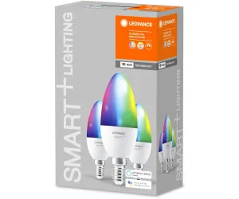

Later version of the Ledvance Smart+ WIFI candle bulb (bk7231n Chip, Firmware 1.3.21) - often sold in trio packs.

Can be flashed with esphome kickstart via [tuya-cloudcutter](https://github.com/tuya-cloudcutter/tuya-cloudcutter) - Profile: profile OEM 1.3.21 

## Product Images



## GPIO Pinout

| Function  | GPIO-Pin |
| --------- | -------- |
| PWM_red   | P3       |
| PWM_green | P2       |
| PWM_blue  | P1       |
| PWM_warm  | P4       |
| PWM_cold  | P5       |

## Basic Configuration

```yaml
#Ledvance Smart+ WIFI bk7231n E14 Candle

substitutions:
  device_name: ledvance-e14-candle
  device_name_letters: ledvancee14candle
  device_description: Ledvance E14 Candle
  friendly_name: Ledvance E14 Candle
  update_interval_seconds: "10s"

esphome:
  name: ${device_name}
  friendly_name: ${friendly_name}

bk72xx:
  board: generic-bk7231n-qfn32-tuya 

wifi:
  <set here>
# Enable fallback hotspot (captive portal) in case wifi connection fails
  ap: 
    <set here>

button:
  - platform: restart
    name: Restart

debug:
  update_interval: 30s

text_sensor:
  - platform: debug
    reset_reason:
      name: Reset Reason

sensor:
  - platform: uptime
    name: Uptime

bp5758d:
    clock_pin: P6
    data_pin: P7

#Adjust min_power as needed. Current config results in fine control in dark/dim colors    
output:
  - platform: bp5758d
    id: output_red
    channel: 3
    min_power: 0.005 #Adjust as desired
    zero_means_zero: true
  - platform: bp5758d
    id: output_green
    channel: 2
    min_power: 0.005 #Adjust as desired
    zero_means_zero: true
  - platform: bp5758d
    id: output_blue
    channel: 1
    min_power: 0.005 #Adjust as desired
    zero_means_zero: true
  - platform: bp5758d
    id: output_warm
    channel: 4
    min_power: 0.0038 #Adjust as desired
    zero_means_zero: true
  - platform: bp5758d
    id: output_cold
    channel: 5
    min_power: 0.0017 #Adjust as desired
    zero_means_zero: true

light:
  - platform: rgbww
    id: light_rgbww
    name: Light
    color_interlock: true
    cold_white_color_temperature: 6500 K
    warm_white_color_temperature: 2700 K
    red: output_red
    green: output_green
    blue: output_blue
    warm_white: output_warm   
    cold_white: output_cold
    constant_brightness: true #Adjust as desired
    default_transition_length: 2s #Adjust as desired
    restore_mode: RESTORE_DEFAULT_OFF #Adjust as desired
```
